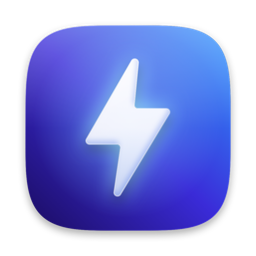
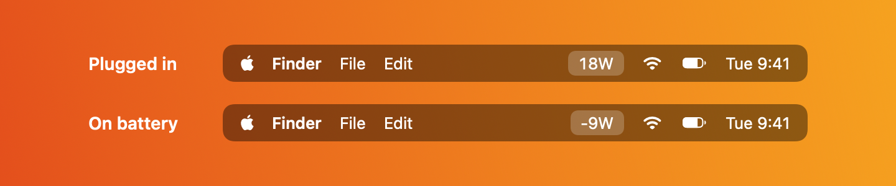
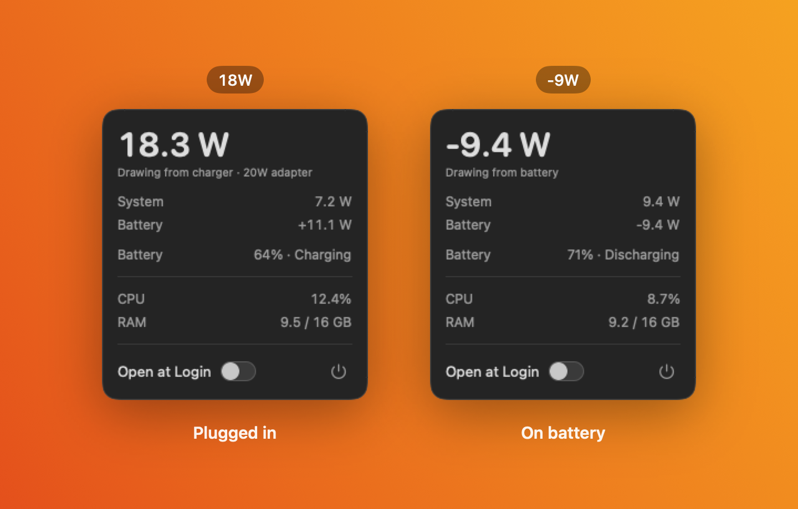
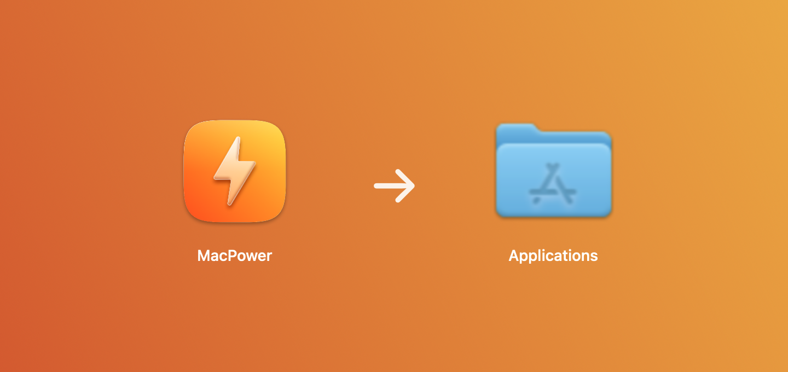
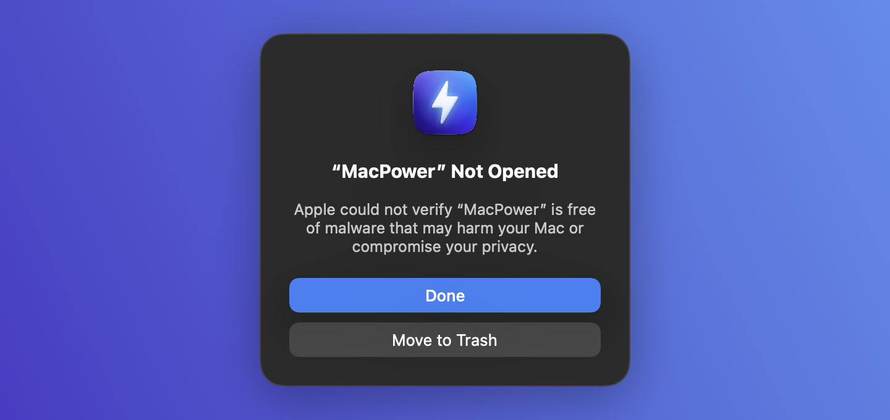

<p align="center">
  
</p>

<h1 align="center">MacPower</h1>

<p align="center">
  A tiny menu bar app that shows how many watts your MacBook is pulling, live.
</p>

<p align="center">
  <a href="https://github.com/atishay1743/MacPower/releases/latest/download/MacPower.dmg"><b>Download for macOS</b></a>
  &nbsp;·&nbsp;
  <a href="https://github.com/atishay1743/MacPower/releases/latest">Release notes</a>
  <br><br>
  <a href="https://github.com/atishay1743/MacPower/releases/latest"></a>
  
  
  <a href="LICENSE"></a>
</p>

<p align="center">
  
</p>

macOS has no built-in live wattage display, so MacPower reads it from IOKit and puts it in the menu bar. The number is always readable at a glance, no clicking needed.

- **Plugged in:** the menu bar shows live charger draw, e.g. `18W`
- **Unplugged:** it shows what the machine is pulling from the battery, as a negative, e.g. `-9W`
- **Click it:** the same figure in large type (e.g. `-9.4 W`, *Drawing from battery*), plus the system vs. battery split, battery percentage and state, overall CPU usage, and RAM used out of total memory. The dropdown shows the same information whether you're plugged in or not.

Readings refresh every five seconds to keep the numbers easy to follow. Plugging or unplugging the charger still updates the power state immediately.

<p align="center">
  
</p>

Requires macOS 14 or later on a Mac with a battery.

## Install

1. Download `MacPower.dmg` from the [latest release](https://github.com/atishay1743/MacPower/releases/latest), open it, and drag **MacPower** onto **Applications**.

   

2. Open MacPower from Applications. macOS will refuse the first time with *“MacPower” Not Opened*. This is expected: the app is not signed with an Apple Developer ID or notarized yet (that costs $99/year), so Gatekeeper blocks any app downloaded outside the App Store that lacks it. Click **Done**.

   

3. Open **System Settings → Privacy & Security**, scroll to **Security**, and click **Open Anyway** next to *“MacPower” was blocked to protect your Mac*. Confirm with your password or Touch ID, then click **Open** in the final prompt. You only need to do this once.

   

   The *Open Anyway* button only shows for about an hour after the failed launch. If it is gone, open the app once more to bring it back.

Prefer the terminal? One command skips steps 2 and 3:

```bash
xattr -dr com.apple.quarantine /Applications/MacPower.app
```

The wattage should appear in your menu bar right away. Turn on **Open at Login** in the dropdown to keep it running; the login item needs a stable location, so move the app to `/Applications` before enabling it. Quit from the dropdown, or with Cmd+Q while it is open.

If you would rather not bypass Gatekeeper at all, [build it from source](#build-from-source). A copy you build yourself is never quarantined.

> The dropdown image is the app's real view rendered with sample readings. The menu bar and install images are simplified illustrations; the exact wording and layout of the macOS dialogs vary slightly between versions.

## Uninstall

Quit MacPower from the dropdown, turn off **Open at Login** first if you enabled it, then drag `MacPower.app` from Applications to the Trash. It keeps no other files.

## Troubleshooting

| Problem | What to try |
| --- | --- |
| *“MacPower” is damaged and can't be opened* | The download is intact; this is the quarantine flag. Run the `xattr` command above. |
| No *Open Anyway* button in Privacy & Security | Try opening the app again, then reopen the Security section. The button expires after about an hour. |
| *Open at Login* won't turn on | Move `MacPower.app` into `/Applications` first, then toggle it again. |
| Menu bar shows `--` | The Mac reports no battery data. Desktop Macs have no battery to read. |
| A reading looks wrong | Open an issue with the output of `ioreg -r -c AppleSmartBattery -w0` and your Mac model. |

## Build from source

Requires the Xcode Command Line Tools (`xcode-select --install`). Full Xcode is not needed.

```bash
./build.sh
open MacPower.app
```

To build the installer:

```bash
./create-dmg.sh
open MacPower.dmg
```

The DMG contains MacPower and an Applications shortcut for drag-and-drop installation. It is ad-hoc signed; to distribute your own build without the warning above you need a Developer ID signature and notarization.

To regenerate the generated assets (all drawn in code, no design files):

```bash
swift scripts/make-icon.swift            # app icon: flat, Liquid Glass–style tile
swift scripts/make-dmg-background.swift  # installer window gradient and arrow
swift run --package-path scripts/render-docs render-docs   # README images in docs/
```

## Where the numbers come from

Live wattage is read from the System Management Controller (SMC), the chip the numbers originate from. No `sudo`, no `powermetrics`, no shell commands.

| Shown as | Source | Units |
| --- | --- | --- |
| Menu bar and headline, plugged in | SMC `PDTR` (power in from the charger) | W |
| Menu bar and headline, on battery | SMC `PSTR` (whole-system power), shown negative | W |
| System | SMC `PSTR` | W |
| Battery | SMC `PPBR`, negative when draining | W |
| Plugged in or not | `IOPSCopyPowerSourcesInfo`, plus a change notification | |
| Adapter rating | `AdapterDetails.Watts` | W |
| Battery percent | `CurrentCapacity` | % |
| CPU | Change in Mach `HOST_CPU_LOAD_INFO` busy ticks across all cores | % (0–100) |
| RAM | Mach `HOST_VM_INFO64`: non-purgeable internal + wired + compressed pages; total from `physicalMemory` | GB (1024³ bytes) |

CPU usage is averaged over the time since the previous reading; the first reading appears after the first refresh interval. RAM estimates memory used by apps, wired memory and compressed memory, excluding reclaimable caches, following the categories in [Activity Monitor](https://support.apple.com/guide/activity-monitor/view-memory-usage-actmntr1004/mac). Values can differ slightly from Activity Monitor because the apps sample at different times.

### Why not the `AppleSmartBattery` registry values?

The registry entry (`PowerTelemetryData`, `Voltage`, `Amperage`) is a cache the system refreshes only every 20 to 60 seconds. Right after you plug in or unplug, it still holds the old state, so the app showed `0W` on plug-in and the last on-battery reading after unplugging. Polling it faster does not help; the data is not there yet.

So the app does three things:

- Reads live values from the SMC.
- Listens for the system's power-source change notification and re-reads immediately when the charger is plugged or unplugged. The next reading follows five seconds later so the sensors have time to settle without a burst of updates.
- Takes the plug state from the real-time power-source API, not the registry, and shows `--` rather than a number that cannot be right for that state (for example `0W` on a connected charger).

The registry is only a fallback on Macs without these SMC sensors, and each value is used only if it fits the current plug state. On those Macs the lag can still appear.

Two more notes:

- The **adapter rating** (e.g. `20W`) is the brick's maximum, not what you are using. The menu bar shows real draw instead.
- Battery `Voltage x InstantAmperage` reads ~0 when the battery is full even though the Mac is still pulling wall power, and `InstantAmperage` swings negative mid-charge, so it is not used for the adapter figure.

## Layout

- `Sources/MacPower/PowerMonitor.swift` — polls power, CPU and RAM every five seconds, with an immediate update on plug or unplug events
- `Sources/MacPower/SMCReader.swift` — live power sensors from the SMC
- `Sources/MacPower/MacPowerApp.swift` — `MenuBarExtra` scene
- `Sources/MacPower/StatusMenuView.swift` — dropdown panel and login item toggle
- `Resources/Info.plist` — `LSUIElement` so there is no Dock icon
- `scripts/` — generators for the app icon, DMG background and README images
- `docs/` — images used by this README
- `build.sh` — compiles and assembles the `.app` bundle
- `create-dmg.sh` — packages the app into a DMG

Built with SwiftPM rather than an Xcode project so it builds with just the Command Line Tools.

## Requirements

macOS 14 or later, on a Mac with a battery. Apple silicon reports the full telemetry set; Intel Macs fall back to battery voltage and current. Building from source needs the Xcode Command Line Tools.

## Contributing

Issues and pull requests are welcome. If a reading looks wrong on your Mac, include the output of `ioreg -r -c AppleSmartBattery -w0` and your Mac model.

## License

[MIT](LICENSE)
